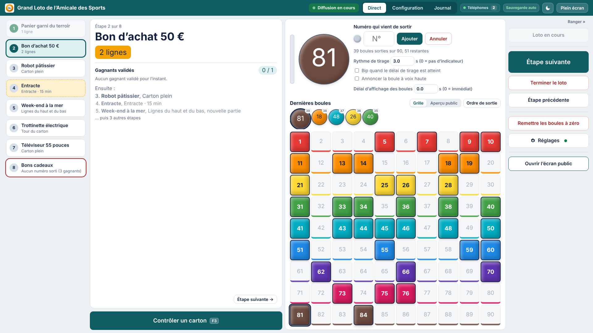
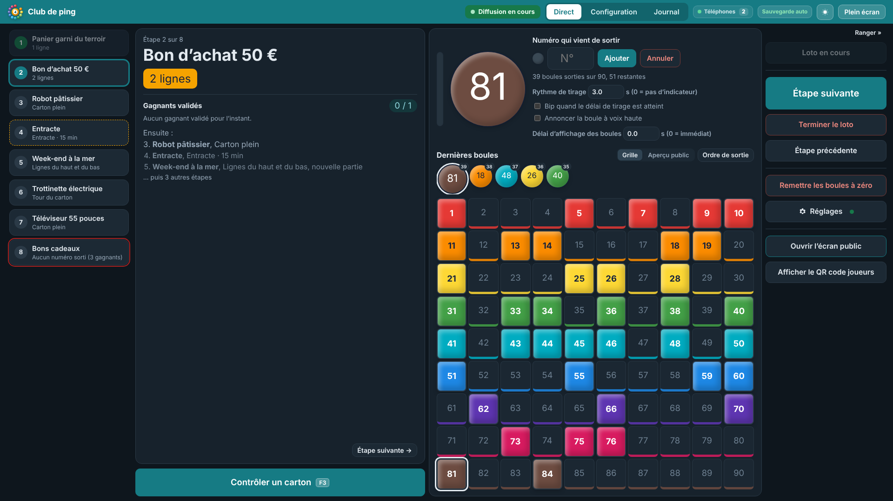
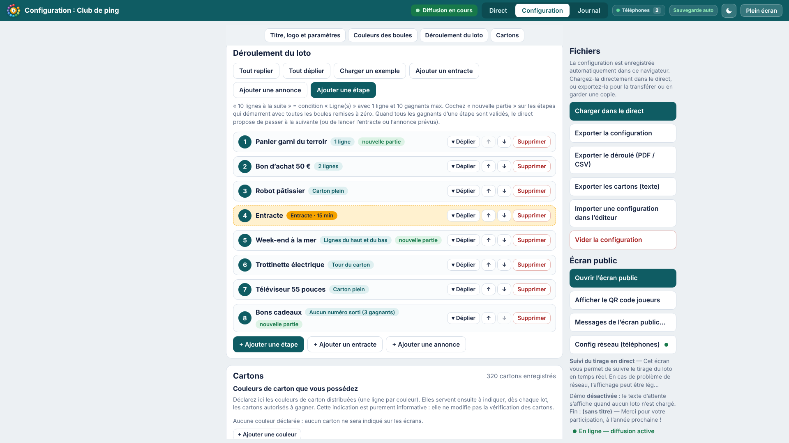
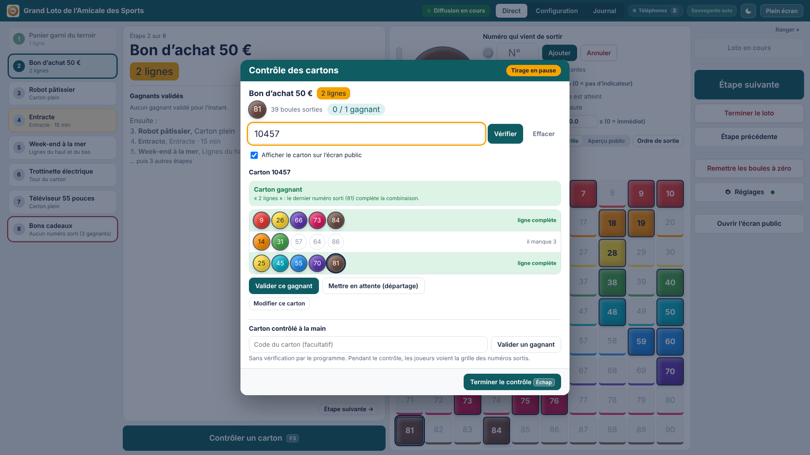
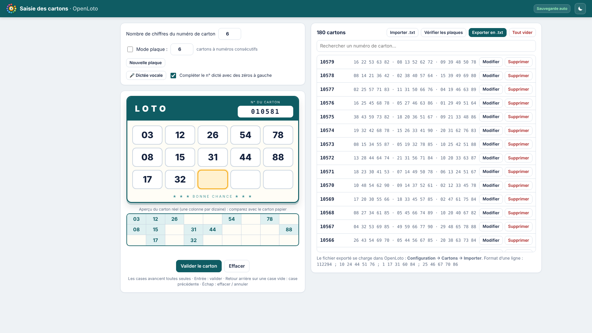
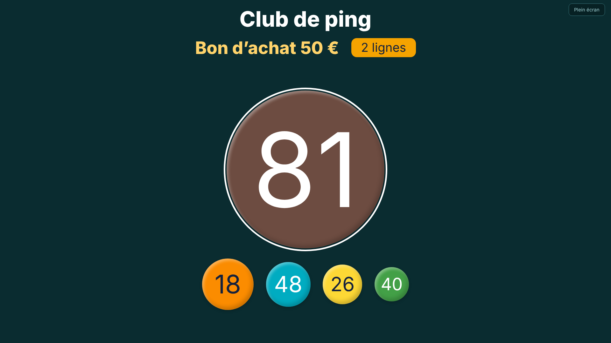
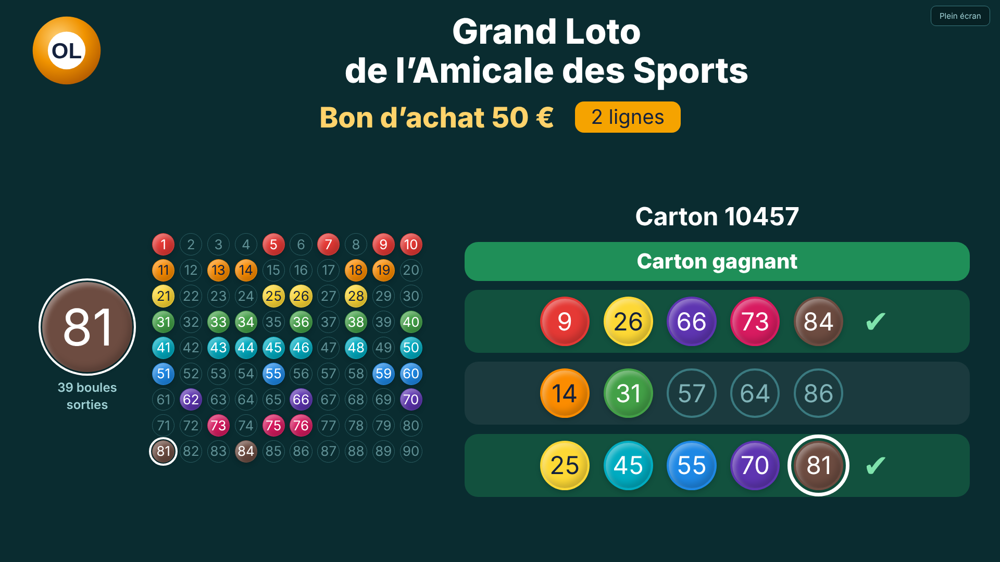
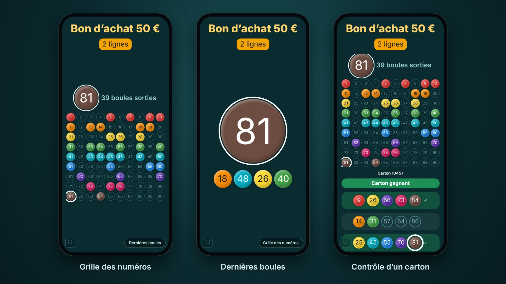

<p align="center">
  <picture>
    <source media="(prefers-color-scheme: dark)" srcset="docs/logo/openloto-logo-blanc.svg">
    
  </picture>
</p>

# OpenLoto

**Gestionnaire de loto pour associations : tirage en direct, contrôle des cartons et écran public, dans un seul fichier HTML.**

OpenLoto s'ouvre dans un navigateur, sans installation ni connexion internet. L'organisateur saisit les boules, contrôle les cartons des gagnants et fait défiler les lots. Le tirage s'affiche sur un écran public (vidéoprojecteur, télé) et, si vous le souhaitez, sur les téléphones des joueurs grâce à un petit serveur : un Raspberry Pi, ou directement le PC de l'organisateur.

> 🌐 **Site du projet :** [openloto.org](https://openloto.org/)

> ✉️ **Une question, une suggestion d'amélioration ?** Écrivez-moi à **[openloto@duck.com](mailto:openloto@duck.com)**, ou ouvrez une demande dans l'onglet **Issues** du dépôt. Tous les retours sont les bienvenus !

> 💡 **Projet : un serveur OpenLoto gratuit**, pour diffuser sur les téléphones sans Raspberry ni installation. Il verra le jour si suffisamment de dons permettent de le faire fonctionner : [voir le projet et ses conditions](#projet--un-serveur-openloto-gratuit).



---

## Fonctionnalités

### Accueil et visite guidée
- À la première ouverture, une page d'accueil présente OpenLoto ; elle se rouvre à tout moment avec le bouton **?** du bandeau.
- **Visite guidée interactive** (environ 4 minutes) : la configuration, puis le direct (démarrer le loto, saisir les boules, contrôler un carton, valider un gagnant, passer au lot suivant, journal).
- La visite se déroule sur un **loto de démonstration** : votre configuration et votre direct sont mis de côté puis remis tels quels à la fin, même si la page est fermée en cours de route. Rien n'est envoyé aux téléphones ; l'écran public affiche un bandeau « DÉMONSTRATION ».

### Le direct
- Saisie des boules au clavier ou tirage aléatoire, avec annulation de la dernière boule.
- Grille des numéros sortis, 5 dernières boules, ordre de sortie.
- Annonce vocale des boules (voix du système), avec une phrase personnalisable (`le {n}`, `{n}… {chiffres}`…) et une répétition automatique.
- Raccourcis clavier configurables (par défaut : F2 saisie, F3 contrôle, F4 valider, F6 répéter, F8 tirage aléatoire, F9 étape suivante, Ctrl+Z annuler).
- Sous le lot en cours, au choix : l'**aperçu de l'écran public** (ce que voit la salle) ou **« Ça chauffe ! »** : combien de cartons de la base sont à 1, 2 ou 3 numéros de la condition du lot, et les numéros les plus attendus (visible seulement par l'organisateur ; les cartons gagnants non réclamés sont mis de côté pour le lot en cours).
- Horloge et durée écoulée depuis le démarrage du loto (en tête de la colonne de droite, ou dans le bloc des boules quand la colonne est rangée).
- Écran maintenu allumé pendant le loto, confirmation avant de fermer la page.
- Thème clair ou sombre, numéro de version affiché dans le bandeau.



### Le déroulé du loto
- Étapes successives : lots, entractes (avec durée) et annonces.
- Conditions de victoire :
  - une ou plusieurs lignes, carton plein ;
  - lignes au choix (ligne du milieu, lignes du haut et du bas, 2 premières, 2 dernières…) ;
  - tour du carton (lignes du haut et du bas, plus les unités et les 80/90 de la ligne du milieu) ;
  - aucun numéro sorti (loto inversé).
- Nombre de gagnants par lot, ou illimité (tous les gagnants d'une même boule).
- Couleurs de cartons par lot, nouvelle partie (boules remises à zéro), note affichée pendant le jeu.
- Avertissement en rouge quand on revient en arrière ou qu'on saute des étapes.



### Le contrôle des cartons
- Fenêtre de contrôle (F3) qui met le tirage en pause.
- Vérification par le code du carton : gagnant, non gagnant ou combinaison complète **avant** la dernière boule (annonce en retard).
- Départage : mise en attente de plusieurs gagnants, choix du gagnant retenu, lot supplémentaire.
- Pendant le contrôle, l'écran public affiche la grille et le carton vérifié.
- Base de cartons importable et modifiable (testé avec plus de 5 000 cartons), avec contrôle des plaques (voir plus bas).



### La saisie des cartons
- Un outil à part, `outils/OpenLoto-saisie-cartons.html`, pour enregistrer vos cartons un par un, au clavier ou à la voix (Chrome et Edge).
- Les cases avancent toutes seules ; un aperçu du carton réel (une colonne par dizaine) permet de comparer d'un coup d'œil avec le carton papier.
- Contrôles à la saisie : numéros de 1 à 90, pas de doublon, un seul numéro par dizaine sur une ligne, numéro de carton unique, carton identique à un autre signalé.
- Mode plaque : numéros de carton consécutifs remplis automatiquement et vérification que chaque numéro de 1 à 90 apparaît une seule fois sur la plaque.
- **Vérification des plaques** : retrouve les plaques de 6 cartons consécutifs et signale les erreurs de saisie probables, avec la correction suggérée (voir plus bas).
- Recherche, modification, suppression (avec annulation), import d'un fichier déjà exporté pour reprendre ou fusionner une saisie.
- Export en `.txt`, à importer dans OpenLoto : **Configuration → Cartons → Importer**.

Pratique pour répartir la saisie entre plusieurs bénévoles : chacun saisit une partie des cartons sur son ordinateur, puis les fichiers exportés sont importés ensemble dans OpenLoto.



### L'écran public
- Fenêtre séparée à placer sur un second écran, ou aperçu dans la page de l'organisateur.
- Titre et logo de l'association (logo allégé automatiquement) : à gauche, à droite, des deux côtés ou au-dessus du titre, toujours parfaitement centré. Lot en cours et condition.
- Logo OpenLoto, au choix : petite signature discrète en bas de l'écran (par défaut), à côté du titre, les deux, ou aucun.
- Animation de chaque nouvelle boule (désactivable), message d'accueil et de fin, mode démo.
- **Photo du lot** (facultative, ajoutée dans l'étape) : affichée en grand à l'annonce du lot, elle s'efface dès la première boule tirée.
- **Partenaires (sponsors)** : leurs logos s'affichent dans des encarts blancs en bas de l'écran, avant le démarrage et pendant les entractes (fixes jusqu'à 4, puis défilement par groupes de 4).
- **Confettis** façon feu d'artifice quand un carton gagnant s'affiche, aussi sur les téléphones (désactivable).
- Photos et logos sont allégés automatiquement et rangés dans le navigateur (IndexedDB) ; ils sont inclus dans les exports de configuration et de sauvegarde. Ils restent sur l'écran public de l'ordinateur : rien de plus n'est envoyé au serveur ni aux téléphones.





### Sur les téléphones (Raspberry Pi ou serveur local)
- Les joueurs suivent le tirage sur leur téléphone via un lien, sans application.
- Le lien s'obtient au choix par un **Raspberry Pi** (ou tout serveur Node.js) ou par le **serveur local** lancé sur le PC de l'organisateur, sur le wifi de la salle.
- **QR code des joueurs** : affiche A4 à imprimer, image PNG, ou affichage à la demande par-dessus l'écran public (retiré automatiquement au démarrage du loto et à la boule suivante).
- Grille complète ou dernières boules (bouton « Grille / Boules »), plein écran avec une marge pour l'appareil photo intégré à l'écran, écran maintenu allumé.
- Nombre de téléphones connectés affiché chez l'organisateur, avec reconnexion automatique.
- Données légères : environ 0,6 Mo par heure et par téléphone.



### Après le loto
- Journal complet de la soirée (boules, gagnants, départages, pic de téléphones connectés).
- Bilan imprimable.
- Export et import de la configuration, sauvegarde complète du direct, export du déroulé en PDF ou CSV.

### Simulation
- Mode simulation pour répéter un loto : nombre de cartons en jeu, vitesse, erreurs de joueurs, durée réelle estimée.

---

## Vérification des plaques et fournisseurs de cartons

Chez certains fournisseurs, les cartons sont imprimés par **plaques de 6 cartons aux numéros consécutifs** (par exemple 106282 à 106287) qui, ensemble, contiennent **chaque numéro de 1 à 90 exactement une fois**. Même vendus à l'unité, ces cartons gardent cette propriété.

OpenLoto s'en sert pour repérer les erreurs de saisie, sans rien deviner :
- les plaques complètes et correctes sont validées ;
- dans une plaque où un numéro apparaît deux fois et un autre manque, la faute de frappe est presque certaine : le contrôle indique sur quel(s) carton(s) elle se trouve et par quel numéro la corriger ;
- pour les plaques dont tous les cartons n'ont pas été saisis, un numéro présent sur deux cartons de la même plaque est aussi signalé.

Le contrôle se lance depuis l'outil de saisie (**Vérifier les plaques**) ou dans OpenLoto (**Configuration → Cartons → Contrôler les plaques**). Sur 2 300 cartons réels, il a retrouvé 205 plaques et signalé 11 erreurs de saisie en moins d'une seconde.

**Fournisseurs dont les cartons suivent cette logique :**

| Fournisseur | Plaques de 6 cartons consécutifs couvrant 1 à 90 |
|---|---|
| Lotoquine | ✓ constaté |

Vous utilisez des cartons d'un autre fournisseur ? Dites-nous, via l'onglet **Issues** du dépôt, si leurs plaques suivent la même règle (ou une autre) : nous compléterons ce tableau.

---

## Démarrage rapide (sans serveur)

1. Téléchargez `OpenLoto.html`.
2. Ouvrez-le avec un navigateur récent (Chrome, Edge ou Firefox). La page d'accueil propose une visite guidée pour découvrir le programme.
3. Dans l'onglet **Configuration**, renseignez le titre, le logo, le déroulé et vos cartons.
4. Cliquez sur **Charger dans le direct**, ouvrez l'écran public et lancez le loto.

Tout est enregistré dans le navigateur de l'ordinateur. Pensez à **exporter la configuration** pour en garder une copie ou la transférer sur un autre poste.

> Pour placer automatiquement l'écran public sur un second écran, utilisez Chrome ou Edge.

---

## Diffusion sur les téléphones : les solutions

| | Raspberry Pi (ou serveur) | Serveur local sur le PC | Serveur OpenLoto *(projet)* |
|---|---|---|---|
| Matériel | un Raspberry Pi ou un serveur Node.js | rien de plus que le PC de l'organisateur | rien |
| Installation | une fois, sur le Pi | aucune (un programme à lancer) | aucune |
| Connexion des joueurs | 4G/5G (ou wifi) via internet | **le même wifi** que le PC | 4G/5G via internet |
| Internet dans la salle | non (pour le PC) | non | **oui** pour le PC (un partage de connexion suffit) |
| Dépend du wifi de la salle | non | **oui** (voir ci-dessous) | non |
| Disponibilité | dès maintenant | dès maintenant | si les dons le permettent ([voir plus bas](#projet--un-serveur-openloto-gratuit)) |

## Serveur local (sans Raspberry)

Le PC de l'organisateur sert lui-même la page aux téléphones, sans internet.

1. Connectez le PC au wifi de la salle, ou à votre propre routeur wifi.
2. Lancez le serveur, à télécharger dans les [Releases](../../releases/latest) du dépôt. Il diffuse le fichier `OpenLoto….html` le plus récent qu'il trouve dans son dossier ou dans le dossier au-dessus.
   - **Windows** : placez `OpenLoto-serveur.exe` dans `serveur-local-windows/` et double-cliquez dessus.
   - Windows peut afficher « Windows a protégé votre ordinateur » (programme non signé) : *Informations complémentaires* → *Exécuter quand même*.
   - Le pare-feu demande une autorisation au premier lancement : acceptez au moins les réseaux privés.
   - **Linux (PC)** : placez `OpenLoto-serveur-linux-x64` dans `serveur-local-linux/`, puis dans un terminal ouvert dans ce dossier : `sh lancer-serveur-linux.sh`. Sans ce fichier, le script utilise Node.js s'il est installé (`sudo apt install nodejs`).
   - **Mac**, ou si l'exécutable est bloqué : installez [Node.js](https://nodejs.org), puis lancez `node serveur-local-windows/openloto-serveur.js`.
3. Dans OpenLoto, sur ce PC : **Réglages → Config réseau → Utiliser le serveur local de ce PC**. L'adresse et la clé se remplissent seules (une nouvelle clé est créée à chaque lancement et récupérée automatiquement).
4. Donnez le lien aux joueurs : QR code, affiche à imprimer ou affichage sur l'écran public.

**Cela dépend des réglages du wifi de la salle.** Beaucoup de wifi publics ou « invités » empêchent les appareils connectés de communiquer entre eux (isolation des clients) : le serveur local ne peut alors pas fonctionner. Testez sur place, ou apportez votre propre routeur wifi : il fonctionne très bien sans internet, et vous pouvez y réserver l'adresse du PC pour qu'elle ne change plus. Sur un wifi sans internet, les téléphones affichent « Pas d'accès à internet » : les joueurs doivent rester connectés à ce wifi.

## Diffusion sur les téléphones (Raspberry Pi)

Le dossier `raspberry/` contient un petit serveur **Node.js sans dépendance**. Il sert la page aux téléphones et leur relaie le tirage en temps réel. L'ordinateur de l'organisateur lui envoie l'état du loto, protégé par une clé de diffusion.

### Installation

Sur le Raspberry Pi (Raspberry Pi OS) :

```bash
# Node.js
sudo apt install -y nodejs

# Utilisateur dédié et dossier du service
sudo useradd --system --no-create-home --shell /usr/sbin/nologin openloto
sudo mkdir -p /opt/openloto

# Fichiers d'OpenLoto
sudo cp OpenLoto.html raspberry/openloto-server.js /opt/openloto/
sudo cp raspberry/openloto.env.example /opt/openloto/openloto.env
sudo cp raspberry/openloto.service /etc/systemd/system/openloto.service

# Clé de diffusion : générez-en une et collez-la dans openloto.env
openssl rand -hex 24
sudo nano /opt/openloto/openloto.env

# Droits et démarrage
sudo chown -R root:openloto /opt/openloto
sudo chmod 640 /opt/openloto/openloto.env
sudo systemctl daemon-reload
sudo systemctl enable --now openloto
```

Le service écoute sur le port **8123**. Après chaque modification de la clé : `sudo systemctl restart openloto`.

Pour mettre OpenLoto à jour, il suffit de remplacer `/opt/openloto/OpenLoto.html` par la nouvelle version (les téléphones la chargent à leur prochaine connexion).

> Installation antérieure (dossier `/opt/loto`, service `loto`) : elle continue de fonctionner telle quelle. Copiez simplement la nouvelle version sous le nom `/opt/loto/Loto.html`.

### Changer le port d'écoute

Le port se règle dans le fichier du service, à la ligne `Environment=PORT=8123` :

```bash
sudo nano /etc/systemd/system/openloto.service
# remplacez 8123 par le port voulu, par exemple : Environment=PORT=8080

sudo systemctl daemon-reload
sudo systemctl restart openloto
```

Pensez ensuite à reporter le nouveau port dans l'adresse du serveur côté organisateur (`http://192.168.1.50:8080`), dans le lien donné aux joueurs et, le cas échéant, dans la redirection de port de votre box.

### Côté organisateur

Dans OpenLoto : **Réglages → Config réseau (téléphones)**.
- **Adresse du serveur** : par exemple `http://192.168.1.50:8123`.
- **Clé de diffusion** : la même que dans `openloto.env`.

Cliquez sur **Tester la connexion**. Le lien à communiquer aux joueurs s'affiche avec son QR code : affiche à imprimer, image PNG, ou affichage sur l'écran public.

> Pour que les joueurs se connectent depuis la 4G/5G plutôt que le wifi de la salle, le port 8123 doit être redirigé vers le Pi sur votre box. Ne publiez jamais votre clé de diffusion.

---

## Projet : un serveur OpenLoto gratuit

Aujourd'hui, pour que les joueurs suivent le tirage sur leur téléphone, il faut un Raspberry Pi (ou un serveur), ou le serveur local sur le PC de l'organisateur avec un wifi qui couvre toute la salle. C'est souvent la partie la plus compliquée pour une association.

**L'idée :** un serveur OpenLoto hébergé sur internet, mis gratuitement à la disposition des associations.

### Comment ça marcherait

1. Sur le site du projet, vous cliquez sur **« Créer une salle »**. **Aucun compte, aucune adresse e-mail** : vous obtenez simplement un code de diffusion.
2. Vous collez ce code dans OpenLoto (**Réglages → Config réseau**).
3. Les joueurs scannent le QR code et suivent le tirage sur leur téléphone, **avec leur propre connexion 4G/5G**.

Plus besoin de Raspberry, de serveur ni du wifi de la salle. Le programme OpenLoto, lui, ne change pas : il reste un simple fichier HTML qui fonctionne sans internet ; seul l'envoi vers les téléphones passe par le serveur.

### Les conditions envisagées

- **Gratuit, sans publicité et sans compte.**
- **Salles temporaires** : une salle est valable pour la durée d'un loto (par exemple 48 heures), puis elle est supprimée automatiquement avec tout son contenu.
- **Données minimales** : le serveur ne reçoit que ce qui s'affiche sur les téléphones (titre et logo de l'association, lot en cours, boules sorties, carton contrôlé). Aucune donnée personnelle, aucun fichier de cartons, rien n'est conservé après la suppression de la salle.
- **Internet nécessaire pour le PC de l'organisateur** : le partage de connexion d'un téléphone suffit, la diffusion consomme très peu.
- **Service bénévole, sans garantie de disponibilité.** Si le serveur ne répond plus, le loto continue normalement : le direct et l'écran public de la salle ne dépendent pas d'internet, seuls les téléphones ne sont plus mis à jour.
- **Usage raisonnable** : des limites pourront être fixées (nombre de salles simultanées par organisateur, durée) pour éviter les abus et garder le service ouvert à tous.
- **Transparence** : les frais du serveur et les dons reçus seront publiés.
- **Rien n'est imposé** : l'auto-hébergement (Raspberry Pi, serveur local) reste possible et documenté, et le code du serveur sera lui aussi libre.

### Ce qu'il faut pour qu'il voie le jour

Un serveur a un coût : la location du serveur, le nom de domaine, et le temps de maintenance (les lotos ont surtout lieu le samedi soir, il faut que tout tienne au même moment). **Le service ne sera ouvert que si suffisamment de dons permettent de le faire fonctionner dans la durée**, avec une réserve pour couvrir au moins une première année.

Si le service ouvre puis que les dons ne suffisent plus à couvrir les frais, il pourra être arrêté, en prévenant à l'avance.

### Vous êtes intéressé ?

- **Faites-le savoir** dans l'onglet **Issues** du dépôt, ou par e-mail à **[openloto@duck.com](mailto:openloto@duck.com)** : nombre de lotos par an, nombre de joueurs, ce qui vous bloque aujourd'hui. C'est ce qui permettra d'évaluer les besoins.
- **Soutenir le projet** : les liens pour faire un don seront ajoutés ici dès qu'ils seront en place.

> Dans OpenLoto, un petit encart **« Diffuser sans Raspberry ? »** (colonne de droite du direct, et page de configuration) présente ce projet ; le bouton **« En savoir plus »** en donne le détail.

---

## Structure du dépôt

```
OpenLoto/
├── OpenLoto.html              Le programme (organisateur + écran public)
├── outils/
│   └── OpenLoto-saisie-cartons.html  Saisie des cartons (export .txt pour OpenLoto)
├── serveur-local-windows/     Serveur local pour Windows
│   ├── openloto-serveur.js    Le serveur (script Node.js)
│   ├── LISEZMOI.txt           Mode d'emploi (+ OpenLoto-serveur.exe des Releases)
│   └── CONSTRUIRE.md          Fabriquer l'exécutable à partir du script
├── serveur-local-linux/       Serveur local pour Linux (PC)
│   ├── openloto-serveur.js    Le même serveur
│   ├── lancer-serveur-linux.sh  Lancement
│   ├── LISEZMOI.txt           Mode d'emploi (+ OpenLoto-serveur-linux-x64 des Releases)
│   └── CONSTRUIRE.md          Fabriquer le programme à partir du script
├── raspberry/
│   ├── openloto-server.js     Serveur de diffusion (Node.js, sans dépendance)
│   ├── openloto.service       Service systemd
│   └── openloto.env.example   Modèle du fichier de clé
├── docs/captures/             Captures d'écran du README
├── docs/logo/                 Logo (SVG, PNG) et image de présentation GitHub
├── LICENSE
└── README.md
```

---

> Les captures d'écran montrent un loto fictif (lots, cartons et association inventés).

## Contact

- Une question, une idée, un bug : l'onglet **Issues** du dépôt (les échanges profitent à tous).
- Pour un message direct : **[openloto@duck.com](mailto:openloto@duck.com)**.

## Note sur le développement

OpenLoto a été conçu et développé avec l'aide d'une intelligence artificielle (Claude, d'Anthropic). Chacun est libre de le reprendre, de l'adapter et de l'améliorer : c'est tout l'esprit de la licence MIT.

## Licence

[MIT](LICENSE) : utilisation, modification et redistribution libres, y compris dans un cadre commercial, à condition de conserver la mention de licence.
